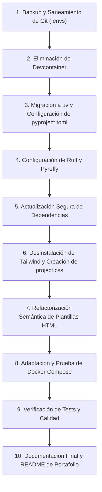

# Plan de Modernización y Refactorización: HereditasArbor

> **Propósito:** Transformar el proyecto universitario en un proyecto destacado de portafolio profesional, aplicando estándares modernos de desarrollo backend con Django, reforzando la seguridad, optimizando la arquitectura de contenedores, simplificando el frontend con CSS nativo semántico y acelerando el ciclo de desarrollo con herramientas de última generación (`uv`, `ruff`, `pyrefly`).

---

## 1. Diagnóstico y Estado Actual del Repositorio

| Aspecto | Estado Actual | Objetivo de Modernización |
| :--- | :--- | :--- |
| **Seguridad de Entorno** | Variables y credenciales reales commiteadas en `.envs/` (incluye tokens de DuckDNS y secret keys en historial de Git). | Purgar `.envs` de todo el historial de Git; adoptar `.envs.example` / `.env.example` y `.gitignore` estricto. |
| **Devcontainer & Docker** | Contenedor de desarrollo acoplado a `.devcontainer` con herramientas innecesarias (`sudo`, `nano`, `dev-user`). | Eliminar `.devcontainer` completamente; conservar y optimizar Docker Compose para desarrollo y producción. |
| **Gestor de Dependencias** | Archivos `requirements/*.txt` tradicionales de pip. | Migrar a formato estándar `pyproject.toml` (PEP 621) gestionado por `uv` con lockfile determinista (`uv.lock`). |
| **Herramientas de Calidad (Dev)** | Mypy tradicional, flake8/black legacy mezclado con ruff parcial. | Toolchain moderna y de ultra alta velocidad: `ruff` (linter + formateador) y `pyrefly` (typechecker de Meta). |
| **Frontend / CSS** | Tailwind CSS compilado mediante script bash (`scripts/tailwind.sh`) descargando binario externo en build y start de Docker. | Eliminar Tailwind y su CLI; implementar CSS nativo semántico con variables CSS y estilizado directo de elementos HTML. |
| **Formularios Django** | `crispy-tailwind` para renderizar formularios. | Eliminar `crispy-tailwind`; utilizar renderizado semántico nativo (`as_div`) o estilos CSS directos sobre inputs. |
| **Lógica de Negocio** | Modelos, vistas, tareas Celery y cálculos hereditarios funcionales. | **Intactos**: no se alterará la lógica de negocio, esquemas de BD ni algoritmos de riesgo. |

---

## 2. Fase 1: Saneamiento del Historial de Git y Gestión de Secretos

### 2.1 Problema Identificado
En los commits históricos (desde el commit inicial `d6d63e5` hasta el actual), la carpeta `.envs/` quedó versionada. Contiene:
- `.envs/.production/.duck`: tokens de DuckDNS reales (`DUCKDNS_TOKEN=<REDACTED_DUCKDNS_TOKEN>`).
- `.envs/.production/.django`: `DJANGO_SECRET_KEY` real de producción.
- `.envs/.local/`: credenciales y configuraciones de entorno local.

Aunque `.gitignore` tenía reglas para `.envs/*`, tenía excepciones explícitas (`!.envs/.local/`, `!.envs/.production/`).

### 2.2 Procedimiento de Remediación
1. **Copia de seguridad local fuera del repo:**
   ```bash
   cp -r .envs /tmp/hereditasarbor_envs_backup
   ```
2. **Generación de archivos `.example` seguros:**
   Crear plantillas documentadas con valores de ejemplo (placeholders):
   - `.envs/.local/.django.example`
   - `.envs/.local/.postgres.example`
   - `.envs/.local/.mail.example`
   - `.envs/.production/.django.example`
   - `.envs/.production/.postgres.example`
   - `.envs/.production/.mail.example`
   - `.envs/.production/.duck.example`
   - `.env.example` en la raíz (para desarrollo fuera de docker o scripts auxiliares).
3. **Actualización de `.gitignore`:**
   ```gitignore
   # Variables de entorno
   .env
   .env.*
   .envs/*
   !.envs/.local/*.example
   !.envs/.production/*.example
   ```
4. **Purga histórica completa con `git-filter-repo`:**
   Ejecutar mediante `uvx` (sin alterar el sistema):
   ```bash
   uvx git-filter-repo --path .envs --invert-paths --force
   ```
   *Nota:* Esto reescribirá los hashes de los 48 commits del repositorio eliminando todo rastro de `.envs`.
5. **Restauración local:**
   Restaurar la carpeta `.envs` desde `/tmp/hereditasarbor_envs_backup` para desarrollo local inmediato, verificando con `git status` que Git la ignore completamente.
6. **Recomendación post-migración:**
   Rotar el token en DuckDNS y regenerar `DJANGO_SECRET_KEY` para producción en caso de que el repositorio alguna vez haya sido público.

---

## 3. Fase 2: Eliminación de Devcontainer y Optimización de Docker

### 3.1 Acciones sobre Devcontainer
1. Eliminar directorio `.devcontainer/` completo (`devcontainer.json`, `bashrc.override.sh`).
2. Limpiar referencias a `.devcontainer` en:
   - `.gitignore` (remover entradas de `.devcontainer/bash_history`).
   - `.pre-commit-config.yaml` (remover `devcontainer.json` del regex de exclusión).

### 3.2 Refactorización de Dockerfiles y Compose
1. **`compose/local/django/Dockerfile`:**
   - Eliminar instalación de paquetes exclusivos de devcontainer: `sudo`, `git`, `bash-completion`, `nano`, `ssh`.
   - Eliminar creación del usuario `dev-user` y reglas en `/etc/sudoers.d/`.
   - Eliminar descarga y ejecución de Tailwind (`COPY ./scripts/tailwind.sh`, `RUN sh /tailwind.sh`).
   - Simplificar hacia una imagen limpia basada en `python:3.12-slim-bookworm`.
2. **`compose/production/django/Dockerfile`:**
   - Eliminar pasos de compilación de Tailwind CLI.
   - Conservar usuario de sistema `django:django` y recolección de estáticos (`collectstatic`).
3. **Scripts de inicio de contenedores (`start`):**
   - En `compose/local/django/start`: eliminar la línea `/usr/bin/tailwindcss ...`.
   - En `compose/production/django/start`: eliminar la línea `/usr/bin/tailwindcss ...`.
4. **Preservación intacta del ecosistema Docker:**
   - Mantener todos los servicios funcionales en `docker-compose.local.yml`: `django`, `postgres`, `redis`, `traefik`, `nginx`, `mailpit`, `celeryworker`, `celerybeat`.
   - Mantener configuración de `docker-compose.production.yml`.

---

## 4. Fase 3: Migración de Dependencias a `uv` y Tooling (`ruff` + `pyrefly`)

### 4.1 Definición de `pyproject.toml` Moderno (PEP 621)
Reemplazar los archivos `requirements/*.txt` por especificaciones estructuradas en `pyproject.toml`:

```toml
[project]
name = "hereditasarbor"
version = "0.2.0"
description = "Aplicación web para gestión de salud y genealogía de enfermedades hereditarias"
readme = "README.md"
requires-python = ">=3.12,<3.13"
dependencies = [
    # Django & Core
    "django>=5.0.9,<5.2",
    "django-environ>=0.11.2",
    "django-model-utils>=5.0.0",
    "django-compressor>=4.5.1",
    "django-redis>=5.4.0",
    "django-filter>=24.3",
    "django-extensions>=3.2.3",
    "django-guardian>=2.4.0",
    # API & Docs
    "djangorestframework>=3.15.2",
    "django-cors-headers>=4.4.0",
    "drf-spectacular>=0.27.2",
    # Utilidades
    "python-slugify>=8.0.4",
    "pillow>=10.4.0",
    "rcssmin>=1.1.2",
    "argon2-cffi>=23.1.0",
    "whitenoise>=6.7.0",
    "cryptography>=43.0.3",
    # Tareas Asíncronas
    "redis>=5.0.8",
    "hiredis>=3.0.0",
    "celery>=5.4.0",
    "django-celery-beat>=2.7.0",
    "flower>=2.0.1",
    # Servidores de Aplicación
    "gunicorn>=23.0.0",
    "uvicorn[standard]>=0.30.6",
    "uvicorn-worker>=0.2.0",
    "psycopg[c]>=3.2.2",
    "django-anymail>=12.0",
    # Análisis de Datos
    "pandas>=2.2.2",
    "numba>=0.60.0",
]

[dependency-groups]
dev = [
    "ruff>=0.9.0",
    "pyrefly>=1.4.0",
    "pytest>=8.3.3",
    "pytest-django>=4.9.0",
    "pytest-sugar>=1.0.0",
    "factory-boy>=3.3.1",
    "django-debug-toolbar>=4.4.6",
    "django-coverage-plugin>=3.1.0",
    "coverage>=7.6.1",
    "djlint>=1.35.2",
    "pre-commit>=3.8.0",
    "watchdog>=4.0.2",
    "werkzeug>=3.0.4",
    "ipdb>=0.13.13",
    "watchfiles>=0.24.0",
    "sphinx>=8.0.2",
    "sphinx-autobuild>=2024.9.3",
]
```

### 4.2 Generación del Lockfile con `uv`
Ejecutar:
```bash
uv lock
```
Esto creará un `uv.lock` multiplataforma, determinista y de instalación instantánea.

### 4.3 Integración de `uv` en Dockerfiles
Aprovechar la imagen oficial de `uv` en los Dockerfiles de Django mediante multi-stage copy:
```dockerfile
COPY --from=ghcr.io/astral-sh/uv:latest /uv /uvx /bin/
ENV UV_SYSTEM_PYTHON=1
COPY pyproject.toml uv.lock ./
RUN uv pip install --system -r pyproject.toml
```
Esto reduce los tiempos de construcción en Docker de minutos a segundos y garantiza reproducibilidad exacta.

### 4.4 Configuración de `ruff` y `pyrefly`
1. **Ruff (Linter y Formatter):**
   - Configurar `[tool.ruff]` en `pyproject.toml` integrando tanto linting como formato de código (`ruff format`).
   - Comandos estándar:
     ```bash
     uv run ruff check . --fix
     uv run ruff format .
     ```
2. **Pyrefly (Typechecker de Meta en Rust):**
   - Añadir configuración en `pyproject.toml` (o `pyrefly.toml`):
     ```toml
     [tool.pyrefly]
     python-version = "3.12"
     project-roots = ["."]
     search-path = ["hereditasarbor"]
     ```
   - Comando de verificación:
     ```bash
     uv run pyrefly check .
     ```
3. **Actualización de Pre-commit:**
   - Actualizar `.pre-commit-config.yaml` para invocar `ruff` y `ruff-format` actualizados, y añadir hook para `pyrefly`.

---

## 5. Fase 4: Actualización Controlada de Dependencias

### 5.1 Criterios de Actualización (Zero Breaking Changes)
Para evitar fallas de compatibilidad con la base de datos o APIs existentes:
- **Python:** Mantener base en `3.12` (compatibilidad comprobada con Numba 0.60 y Pandas 2.2).
- **Django:** Actualizar dentro de la serie 5.x compatible (`5.0.12` o `5.1.x`), validando que ninguna migración ni backend de auth sufra deprecaciones.
- **Librerías de Base de Datos y Redis:** Actualizar `psycopg[c]` a `3.2.x`, `redis` a `5.2.x`, `django-redis` a `5.4.x`.
- **DRF:** Mantener en `3.15.x` compatible con `drf-spectacular 0.28.x`.
- **Eliminar dependencias obsoletas:** Remover `crispy-tailwind`.

### 5.2 Verificación de Migraciones
Ejecutar verificación de integridad tras actualizar:
```bash
uv run python manage.py makemigrations --check
```

---

## 6. Fase 5: Eliminación de Tailwind CSS y Nuevo Sistema CSS Semántico

### 6.1 Desmontaje de Tailwind
1. Eliminar archivos de configuración y scripts:
   - `rm scripts/tailwind.sh`
   - `rm tailwind.config.js`
2. Modificar `config/settings/base.py`:
   - Remover `"crispy_tailwind"` de `THIRD_PARTY_APPS`.
   - Remover `CRISPY_TEMPLATE_PACK = "tailwind"` y `CRISPY_ALLOWED_TEMPLATE_PACKS = "tailwind"`.
3. Actualizar `hereditasarbor/templates/base.html`:
   - Cambiar referencia de `<link href="" ...>` por ``.

### 6.2 Arquitectura del Sistema de Diseño CSS Nativo (`project.css`)
Diseñar una hoja de estilos moderna, limpia y responsive, organizada en capas lógicas:

```
hereditasarbor/static/css/project.css
├── 1. Custom Properties (Tokens de color de marca, fuentes, espaciado, sombras)
├── 2. Modern Reset & Box-Sizing
├── 3. Element Styling (Tipografía, Enlaces, Botones, Tablas, Formularios e Inputs)
├── 4. Layout & Grid (Container, flexbox/grid utilitarios semánticos)
├── 5. Component Classes (Cards, Navbar, Dropdown, Badges, Alerts)
└── 6. Media Queries & Responsive Design
```

#### A. Variables de Marca (CSS Tokens)
Preservar la identidad visual del proyecto (verde bosque/tierra):
```css
:root {
  --color-primary: #475f45;
  --color-primary-dark: #343d33;
  --color-primary-light: #5a7558;
  --color-primary-contrast: #ffffff;
  --color-bg-page: #f8faf8;
  --color-bg-card: #ffffff;
  --color-bg-footer: #414840;
  --color-text-main: #2d3748;
  --color-text-muted: #6b7280;
  --color-border: #e2e8f0;
  --color-danger: #dc2626;
  --color-success: #16a34a;
  --font-serif: Georgia, Cambria, serif;
  --font-sans: -apple-system, BlinkMacSystemFont, "Segoe UI", Roboto, sans-serif;
  --radius-sm: 4px;
  --radius-md: 8px;
  --radius-lg: 12px;
  --shadow-sm: 0 1px 2px rgba(0, 0, 0, 0.05);
  --shadow-md: 0 4px 6px -1px rgba(0, 0, 0, 0.1);
  --transition: all 0.2s ease-in-out;
}
```

#### B. Estilizado Directo de Elementos HTML
Para que cualquier elemento estándar se vea pulido sin necesidad de clases adicionales:
- **Headings (`h1`, `h2`, `h3`, `h4`):** Familia tipográfica serif, color `--color-primary-dark`, espaciado consistente.
- **Formularios e Inputs (`input`, `select`, `textarea`):**
  - Ancho completo (`width: 100%`), padding ergonómico, bordes suaves, focus ring con `--color-primary`.
  - Estilos específicos para inputs de tipo `date`, `number`, `email`, `password`.
  - Elementos `label` en negrita suave y con separación vertical.
- **Botones (`button`, `input[type="submit"]`):**
  - Estilo base sólido con fondo `--color-primary`, texto blanco, bordes redondeados y efecto hover interactivo.
- **Tablas (`table`, `th`, `td`):**
  - Ancho completo, colapso de bordes, encabezados sutiles en gris claro, padding de celdas y hover en filas.

#### C. Clases de Componentes Semánticas
- `.container`: Máximo ancho centrado con padding responsive.
- `.card`: Superficie blanca con borde tenue, padding y sombra suave.
- `.grid-cards`: Grid responsive con auto-fit (`repeat(auto-fit, minmax(280px, 1fr))`).
- `.btn-outline`: Variante de botón transparente con borde verde.
- `.navbar` y `.nav-links`: Estructura para el menú de navegación y dropdown de usuario.
- `.alert`: Mensajes flash de Django (`success`, `error`, `info`) con indicador de estado.

### 6.3 Refactorización de Plantillas HTML
1. **Formularios (`users/login`, `users/create`, `family/create`, etc.):**
   - Reemplazar `{{ form|crispy }}` por renderizado limpio con `{{ form.as_div }}` o campos individuales. Al estar estilizados los elementos `input`, `select`, `label` y `div`, el formulario adquiere un diseño uniforme automáticamente.
2. **Componentes Globales:**
   - `hereditasarbor/templates/components/layout/haeder.html`: Reemplazar la acumulación de utilidades de Tailwind por clases semánticas `.navbar`, `.brand-logo`, `.nav-menu`, `.dropdown`.
   - `hereditasarbor/templates/components/layout/footer.html`: Usar `.footer-main`, `.footer-links`, variables de color.
   - `hereditasarbor/templates/components/layout/messages.html`: Usar `.alert-container`, `.alert-item`.
3. **Páginas Principales:**
   - `pages/home.html`: Hero section con `.hero-container`, `.hero-title`, `.hero-text`, `.hero-image`.
   - `family/views/family_list.html`: Sustituir clases largas por `.grid-cards` y `.card`.
   - `analytics/views/analytics_list.html`: Tabla semántica `<table>` con estilos por elemento.

---

## 7. Fase 6: Pruebas, Validación y Pulido de Portafolio

### 7.1 Matriz de Verificación
| Prueba / Validación | Comando | Criterio de Éxito |
| :--- | :--- | :--- |
| **Linting & Formato** | `uv run ruff check .` y `uv run ruff format --check .` | 0 errores y advertencias. |
| **Verificación de Tipos** | `uv run pyrefly check .` | Tipado consistente sin inconsistencias críticas. |
| **Integridad de Migraciones** | `uv run python manage.py makemigrations --check` | "No changes detected". |
| **Suite de Tests** | `uv run pytest` | Todos los tests pasan exitosamente. |
| **Construcción Docker** | `docker compose -f docker-compose.local.yml build` | Build limpio sin dependencias de Tailwind CLI ni devcontainer. |
| **Ejecución Local Docker** | `docker compose -f docker-compose.local.yml up -d` | Todos los servicios (Django, DB, Redis, Celery, Traefik, Nginx) saludables. |
| **Auditoría de Git** | `git log --all --full-history -- ".envs*"` | Salida vacía (ningún rastro de secretos en commits). |

### 7.2 Presentación para Portafolio (Actualización de `README.md`)
Un README profesional que resalte la madurez del proyecto:
- **Badges:** Python 3.12, Django 5.x, uv, Ruff, Docker, Pyrefly.
- **Descripción del Dominio:** Explicar el propósito médico-genealógico (análisis de predisposiciones genéticas y árboles familiares).
- **Decisiones de Arquitectura:**
  - Por qué se migró a `uv` (velocidad, reproducibilidad).
  - Por qué se eliminó Tailwind a favor de CSS moderno nativo (cero dependencias de compilación en frontend, rendimiento óptimo, maestría en CSS nativo).
  - Arquitectura en contenedores (Traefik, Nginx, Celery, Redis, PostgreSQL).
- **Guía Rápida de Inicio:** Cómo levantar el proyecto en 2 comandos con Docker o localmente con `uv`.

---

## 8. Cronograma de Ejecución Paso a Paso



1. **Paso 1:** Backup de `.envs` y purga histórica con `uvx git-filter-repo`.
2. **Paso 2:** Crear `.envs.example` y asegurar `.gitignore`.
3. **Paso 3:** Eliminar `.devcontainer/` y limpiar Dockerfiles de paquetes y usuarios de devcontainer.
4. **Paso 4:** Crear `pyproject.toml`, generar `uv.lock`, agregar `ruff` y `pyrefly`.
5. **Paso 5:** Eliminar scripts y configuraciones de Tailwind (`tailwind.sh`, `tailwind.config.js`).
6. **Paso 6:** Implementar `project.css` con variables CSS y estilizado completo de elementos HTML y componentes.
7. **Paso 7:** Refactorizar templates reemplazando clases de Tailwind y `crispy-tailwind` por HTML semántico y CSS nativo.
8. **Paso 8:** Actualizar Dockerfiles para instalar dependencias mediante `uv` y eliminar la llamada a Tailwind en `start`.
9. **Paso 9:** Ejecutar `pytest`, `ruff check`, `pyrefly check` y probar inicio en Docker Compose.
10. **Paso 10:** Actualizar `README.md` orientado a reclutadores y portfolio.
